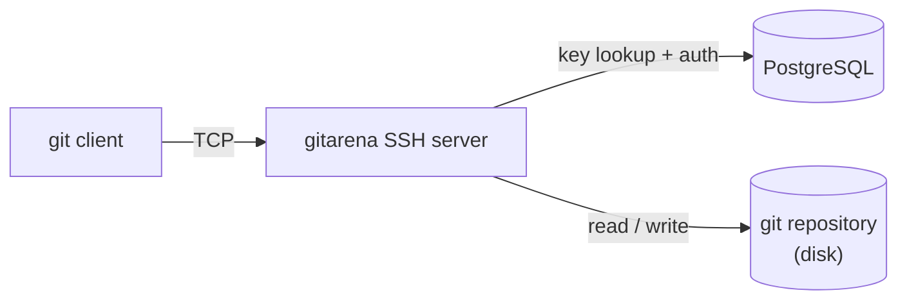

The main `gitarena` binary includes a built-in SSH server that handles git push and pull over SSH. It runs alongside the HTTP server as part of the same process.

## How it works

When a client connects, the server authenticates the user by their public key and then processes the git command (`git-upload-pack` or `git-receive-pack`) directly:



<Steps>
  <Step title="Connect and authenticate">
    The client connects and presents a public key. The server looks up the key in the `ssh_keys` table and resolves the associated user.
  </Step>
  <Step title="Exec request">
    The client sends a `git-upload-pack` or `git-receive-pack` exec request. The server checks repository access and push permissions.
  </Step>
  <Step title="Ref advertisement">
    The server sends the ref advertisement to the client.
  </Step>
  <Step title="Data exchange">
    The client streams its request (object negotiation or pack data). The server processes it and streams the response back.
  </Step>
</Steps>

## Git protocol versions

GitArena supports git protocol v0, v1 and v2 over both SSH and smart HTTP. The git client picks the version with its `protocol.version` setting. Over SSH, git sends the choice in the `GIT_PROTOCOL` environment variable. Over smart HTTP, it sends the `Git-Protocol` header.

When the client sends no version, GitArena uses v0. To choose a version for every repository, set it in your git config:

```bash
git config --global protocol.version 2
```

To choose a version for a single command, pass `-c protocol.version`:

```bash
git -c protocol.version=1 clone git@your-instance:username/repo.git
```

| Version | Client sends         | Upload-pack advertisement                              |
|---------|----------------------|--------------------------------------------------------|
| v0      | No version (default) | Full ref list with capabilities                        |
| v1      | `version=1`          | `version 1` line, then full ref list with capabilities |
| v2      | `version=2`          | Capabilities only (no refs)                            |

## Authentication

Only public key authentication is accepted. Password authentication is rejected. The SSH username must be `git` — this is standard practice for git hosting services:

```bash
git clone git@your-instance:username/repo.git
```

Users manage their SSH keys through account settings in the web UI. See the [API reference](/api-reference/introduction) for the key management endpoints.

## Configuration

The SSH server reads its settings from the `settings` table:

| Setting | Default | Description |
|---------|---------|-------------|
| `ssh.enabled` | `true` | Enable or disable the SSH server |
| `ssh.port` | `2222` | Port the server binds to |
| `ssh.private_key` | Generated | Private host key stored after first startup |

The server host key is generated automatically on first start and stored in the `ssh.private_key` setting. It persists across restarts and cannot be overridden from the environment.

## Supported key types

The following public key types are accepted:

| Key type                             | Algorithm                           |
|--------------------------------------|-------------------------------------|
| `ssh-ed25519`                        | Ed25519                             |
| `sk-ssh-ed25519@openssh.com`         | Ed25519 (FIDO/U2F security key)     |
| `ecdsa-sha2-nistp256`                | ECDSA P-256                         |
| `ecdsa-sha2-nistp384`                | ECDSA P-384                         |
| `ecdsa-sha2-nistp521`                | ECDSA P-521                         |
| `sk-ecdsa-sha2-nistp256@openssh.com` | ECDSA P-256 (FIDO/U2F security key) |
| `ssh-rsa`                            | RSA (SHA-1)                         |
| `rsa-sha2-256`                       | RSA (SHA-256)                       |
| `rsa-sha2-512`                       | RSA (SHA-512)                       |

DSA keys are not accepted.

## Shell access

If a user connects without issuing a git command (e.g. by opening an interactive SSH session), the server greets them by name and closes the connection. Shell access is not provided.
